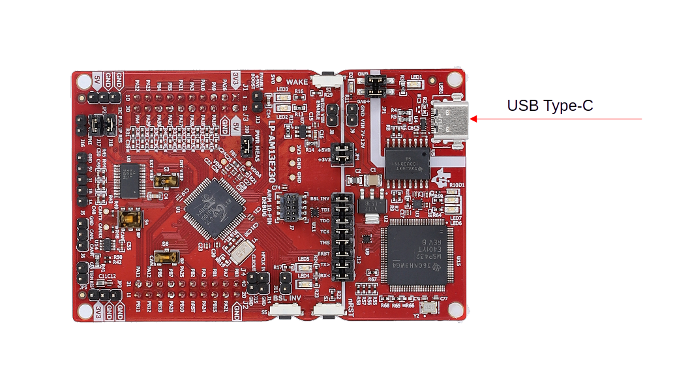

Step 2: Board Setup
###################

.. note::

   This page is a placeholder. Detailed board setup steps will be added once
   the AM13 SDK installer is finalized.

Connect your AM13 LaunchPad (``lp_am13e230``) to the host PC with a USB cable.

