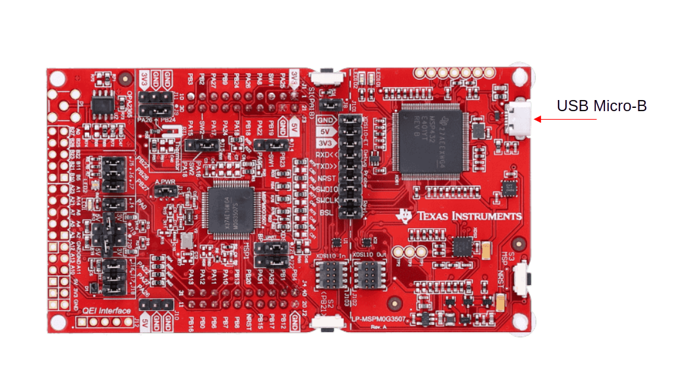
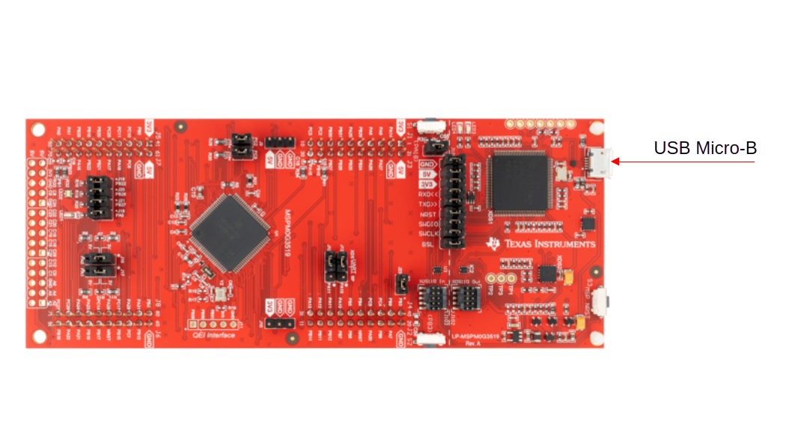
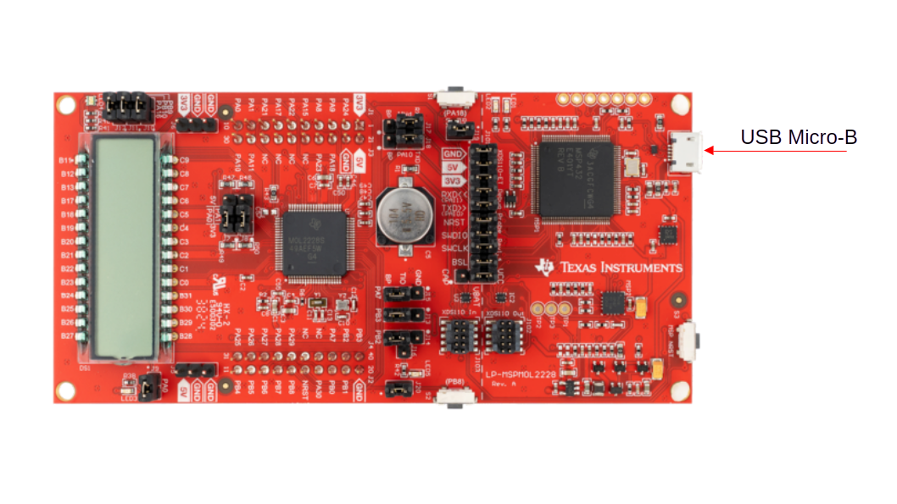

Step 2: Board Setup
###################

Connect your MSPM0 LaunchPad (``lp_mspm0g3507``, ``lp_mspm0g3519`` or
``lp_mspm0l2228``) to the host PC with a USB cable.

   LP-MSPM0G3507

   LP-MSPM0G3519

   LP-MSPM0L2228
