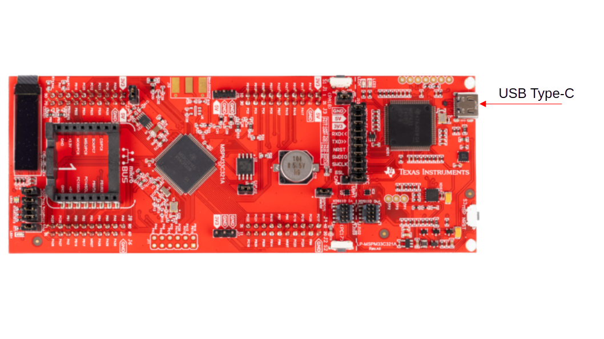

Step 2: Board Setup
###################

.. note::

   This page is a placeholder. Detailed board setup steps will be added once
   the MSPM33 SDK installer is finalized.

Connect your MSPM33 LaunchPad (``lp_mspm33c321a``) to the host PC with a USB
cable.

