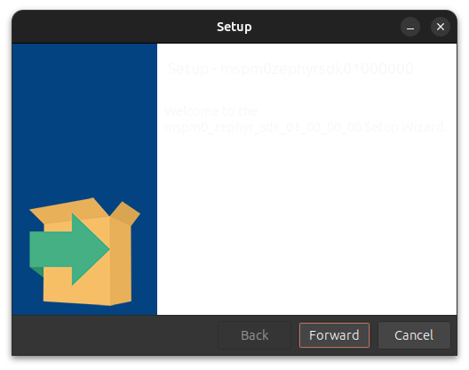
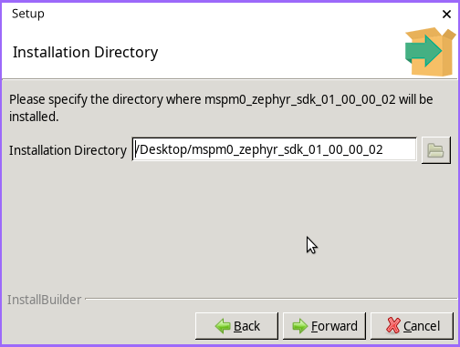
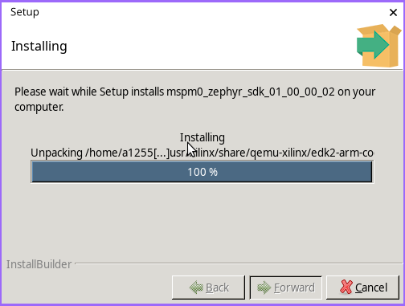
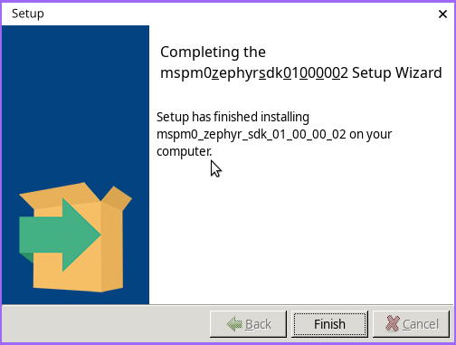

Step 1: Download, Install and Setup the SDK and Tools
#####################################################

.. note::
   This guide covers Ubuntu version 24.04 LTS and later.

The SDK installer places the Zephyr workspace and toolchain in
<sdk-install-dir>. Host packages and the Python environment are set up as
described under Setup.

Download
********

Download the MSPM33 SDK installer from `MSPM33-ZEPHYR-SDK page <https://www.ti.com/tool/download/MSPM33-ZEPHYR-SDK>`__

Install
*******

Run the installer and follow its prompts. The SDK is installed to
``<sdk-install-dir>``, which the following steps refer to.

Once the installer is downloaded on the system, open the properties of the `.run` file and toggle the option for `Executable as Program` to `on`

Run the installer and follow the below instructions:

Opening Screen of the installer (Click Forward) 

Choose installation directory (by default it chooses <home>/ti/<SOC_SDK>) -

Wait for the Installation to complete -

Click finish -

**The SDK is installed**

Setup
*****

Run the setup script once after the installation:

.. code-block:: shell

   cd <sdk-install-dir>
   source setup_env.sh

The script checks that the host packages are present (``git``, ``cmake``,
``ninja-build``, ``gperf``, ``python3`` and ``python3-venv``; it prints the
``sudo apt-get`` command to install any that are missing and exits, it does not
install them itself), creates a Python virtual environment in
``<sdk-install-dir>/.venv`` with ``west`` and the Python requirements of Zephyr
(Python 3.12 or later is required), and prepares the bundled host tools.

In every new terminal, activate the environment before building or flashing:

.. code-block:: shell

   source <sdk-install-dir>/.venv/bin/activate

Activating the environment sets ``ZEPHYR_BASE`` and ``ZEPHYR_SDK_INSTALL_DIR``,
so ``west`` finds the Zephyr tree and the toolchain in ``<sdk-install-dir>``.
No global CMake registry entries are written.
