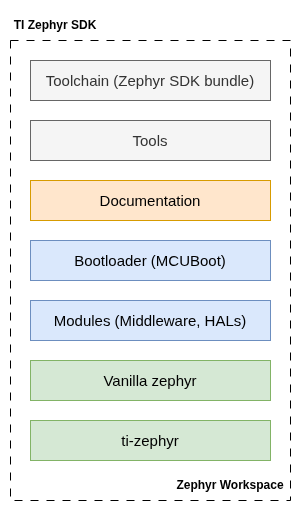

.. _ti-zephyr-introduction:

Introduction
############

Zephyr SDK is a west workspace based SDK that provides TI-specific samples and tests along with upstream
`Zephyr RTOS <https://zephyrproject.org>`_.

Block Diagram
**************
Given below is a block diagram of the SW modules in this SDK,

Software Components
*******************

The main software components in the block diagram are described below. Except
for the toolchain, they are part of the Zephyr workspace, whose contents are
defined by the west manifest (``west.yml``) in ``ti-zephyr``.

.. list-table::
   :header-rows: 1
   :widths: 20 25 55
   :class: force-wrap

   * - Software Component
     - Documentation Page
     - Description
   * - Toolchain (Zephyr SDK bundle)
     - `Zephyr SDK <https://docs.zephyrproject.org/latest/develop/toolchains/zephyr_sdk.html>`__
     - Cross-compilation toolchain and host tools from the Zephyr SDK bundle,
       used to build the SDK and applications. It is installed by the SDK
       installer; see :ref:`Getting Started <ti-zephyr-getting-started>`.
   * - Bootloader (MCUboot)
     - `MCUboot <https://docs.mcuboot.com/>`__
     - MCUboot secure bootloader, imported from TI's MCUboot fork into
       ``bootloader/mcuboot`` of the workspace.
   * - Tools
     - :ti-ref:`Tools and Utilities <ti-zephyr-tools>`
     - Host tools used while developing with the SDK, such as
       `west <https://docs.zephyrproject.org/latest/develop/west/index.html>`__
       for workspace management, building, flashing and debugging, and the
       flashing tools for the target SoC.
   * - Modules (Middleware, stacks, HALs)
     - `Zephyr Modules <https://docs.zephyrproject.org/latest/develop/modules.html>`__
     - Hardware abstraction layers (such as ``hal_ti``), middleware and
       protocol stacks (such as LVGL, mbed TLS, littlefs and OpenThread),
       imported as west projects under ``modules/``.
   * - Vanilla Zephyr
     - `Zephyr Documentation <https://docs.zephyrproject.org/latest/>`__
     - The Zephyr RTOS (kernel, subsystems, device drivers, devicetree, board
       and SoC support) from TI's Zephyr repository (``TexasInstruments/zephyr``),
       at the revision pinned by the west manifest.
   * - ti-zephyr
     - :ref:`Samples and Tests <ti-zephyr-samples-and-tests>`
     - The SDK's own Zephyr module and west manifest repository. It provides
       the TI-specific samples, tests, devicetree bindings, out-of-tree drivers
       and reference application scaffolding.

Directory Structure
*******************

Given below is an overview of the directory structure to help you navigate the
SDK and related tools.

The SDK is a west workspace. ``<sdk-install-dir>`` is the directory the SDK
installer installs it to, as used in :ref:`Getting Started
<ti-zephyr-getting-started>`.

.. list-table::
   :header-rows: 1
   :widths: 30 70

   * - Directory
     - Description
   * - ``<sdk-install-dir>/zephyr/``
     - Zephyr RTOS.
       directory.
   * - ``<sdk-install-dir>/ti-zephyr/``
     - The ``ti-zephyr`` module and west manifest repository, described below.
   * - ``<sdk-install-dir>/modules/``
     - Zephyr modules imported by the manifest: HALs, middleware and stacks.
   * - ``<sdk-install-dir>/bootloader/``
     - MCUboot (``bootloader/mcuboot``).
   * - ``<sdk-install-dir>/tools/``
     - Helper tools imported by the manifest, for example ``net-tools``.

The ``ti-zephyr`` module is organized as follows:

.. list-table::
   :header-rows: 1
   :widths: 30 70

   * - ``ti-zephyr/``
     - Description
   * - ``west.yml``
     - West manifest; pins Zephyr and every TI-relevant module.
   * - ``zephyr/module.yml``
     - Zephyr module description that registers the devicetree root, samples
       and tests of this repository with the build system.
   * - ``drivers/``
     - Out-of-tree drivers.
   * - ``samples/``
     - TI sample applications; see
       :ref:`Samples and Tests <ti-zephyr-samples-and-tests>`.
   * - ``dts/``, ``include/``, ``lib/``
     - Devicetree bindings, public headers and libraries.
   * - ``applications/``
     - Reference application scaffolding.
   * - ``cmake/``
     - Shared CMake extensions.
   * - ``modules/``
     - TI modules pending their own west projects.
   * - ``scripts/``
     - Development tooling.
   * - ``doc/``
     - Sphinx sources of this documentation.

.. only:: mspm0

   In addition, the OpenOCD flashing tool is installed in
   ``<sdk-install-dir>/openocd/``, and ``ti-zephyr/tests/`` holds the TI test
   suites; see :ti-ref:`Tests <ti-zephyr-tests>`.

.. only:: mspm33

   In addition, the OpenOCD flashing tool is installed in
   ``<sdk-install-dir>/openocd/``, and ``ti-zephyr/tests/`` holds the TI test
   suites; see :ti-ref:`Tests <ti-zephyr-tests>`.

.. only:: am13

   In addition, the OpenOCD flashing tool is installed in
   ``<sdk-install-dir>/openocd/``, and ``ti-zephyr/tests/`` holds the TI test
   suites; see :ti-ref:`Tests <ti-zephyr-tests>`.

Supported Hardware
******************

Refer |soc_board_support| for the supported boards.

Licenses
********

.. only:: mspm0

   The licensing information of this SDK, as well as any third-party components included which are made available under a number of other open-source licenses are enumerated as part of the manifest.
   A complete manifest along with export control information is detailed `here <../../MSPM0-ZEPHYR-SDK_manifest.html>`_

.. only:: mspm33

   The licensing information of this SDK, as well as any third-party components included which are made available under a number of other open-source licenses are enumerated as part of the manifest.
   A complete manifest along with export control information is detailed `here <../../MSPM33-ZEPHYR-SDK_manifest.html>`_

.. only:: am13

   The licensing information of this SDK, as well as any third-party components included which are made available under a number of other open-source licenses are enumerated as part of the manifest.
   A complete manifest along with export control information is detailed `here <../../AM13E2X-ZEPHYR-SDK_manifest.html>`_

.. only:: am62l

   The licensing information of this SDK, as well as any third-party components included which are made available under a number of other open-source licenses are enumerated as part of the manifest.
   A complete manifest along with export control information is detailed `here <../../AM62L-ZEPHYR-SDK_manifest.html>`_

Help and Support
****************

For additional help and support, see
https://e2e.ti.com/support/processors/f/processors-forum
